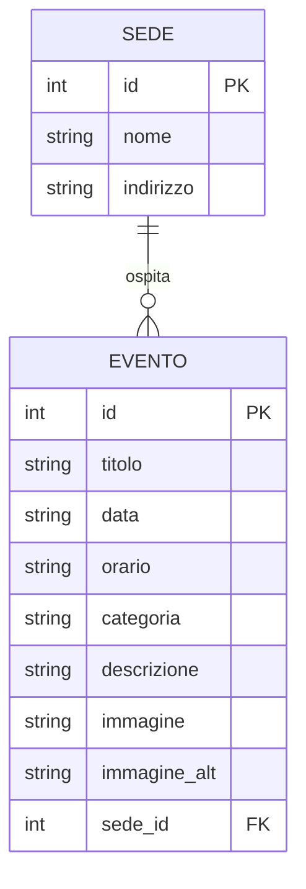

# Schema dei dati — Segnale

## 1. Entità

- Evento: rappresenta un appuntamento del festival Segnale.
- Sede: rappresenta il luogo in cui si svolgono gli eventi.

## 2. Campi, tipi ed esempi

### Evento

| Campo | Tipo | Esempio |
|---|---|---|
| id | Numero intero | 1 |
| titolo | Testo | Lettere in movimento |
| data | Testo (AAAA-MM-GG) | 2026-06-12 |
| orario | Testo (HH:MM) | 10:00 |
| categoria | Testo | Incontro |
| descrizione | Testo | Un incontro sulla tipografia |
| immagine | Testo | assets/lettere-in-movimento.svg |
| immagine_alt | Testo | Lettere geometriche disposte su una griglia |
| sede_id | Numero intero | 1 |

### Sede

| Campo | Tipo | Esempio |
|---|---|---|
| id | Numero intero | 1 |
| nome | Testo | Officina Nord — Sede centrale |
| indirizzo | Testo | Corso Duca degli Abruzzi 24, Torino |

## 3. Chiavi

- Chiave primaria di Evento: id.
- Chiave primaria di Sede: id.
- Chiave esterna di Evento: sede_id, che fa riferimento all'id della sede.

## 4. Relazione

Una sede può ospitare zero o più eventi; ogni evento si svolge in una sola sede.

## 5. Quantità

- 6 eventi nel file dati/eventi.json.
- 3 sedi nel file dati/sedi.json.

## 6. Aggiornamento dei dati

Il responsabile del sito aggiorna direttamente i file JSON tramite Visual Studio Code, mantenendo gli identificativi univoci e verificando la corrispondenza tra gli eventi e le sedi. Le modifiche vengono salvate e pubblicate tramite GitHub.

## 7. Visualizzazione nella pagina

La pagina programma.html mostra le sei schede degli eventi generate tramite JavaScript a partire dai file JSON.

Ogni scheda presenta la data, l'orario, la categoria, il titolo, la descrizione, l'immagine e il nome della sede corrispondente.
